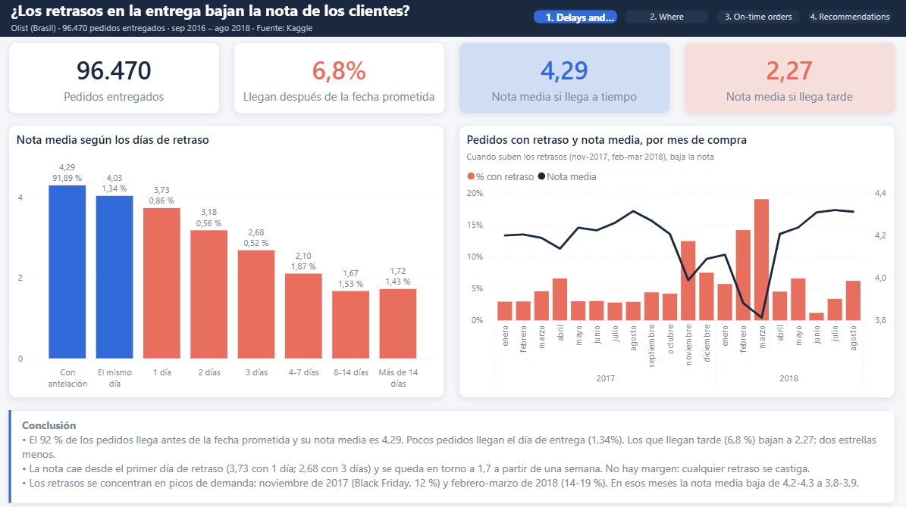
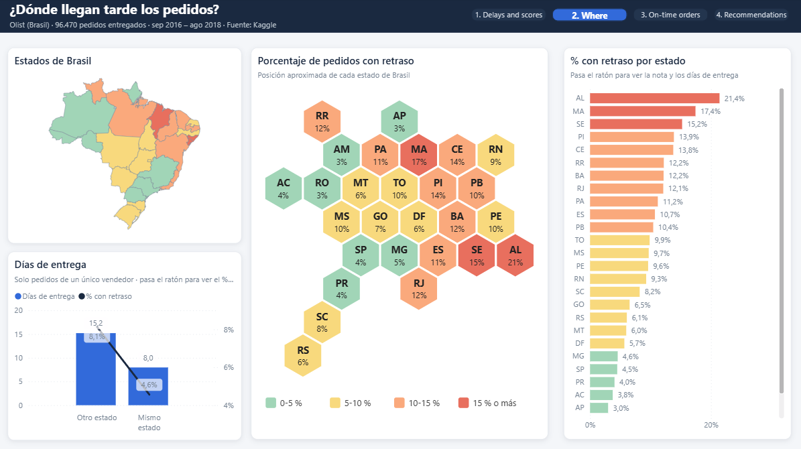
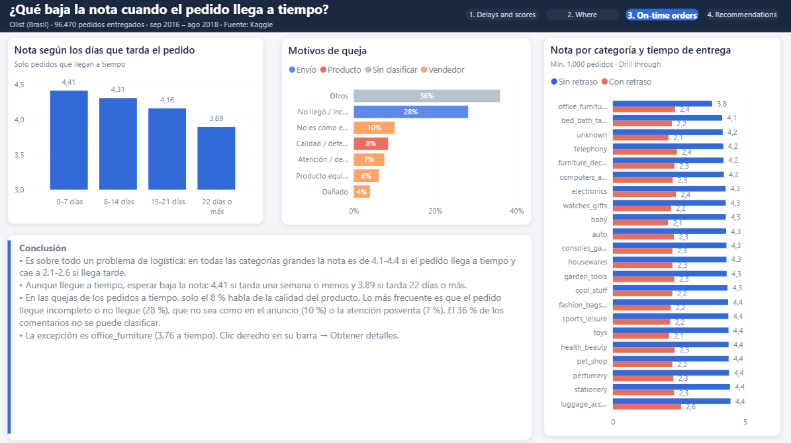
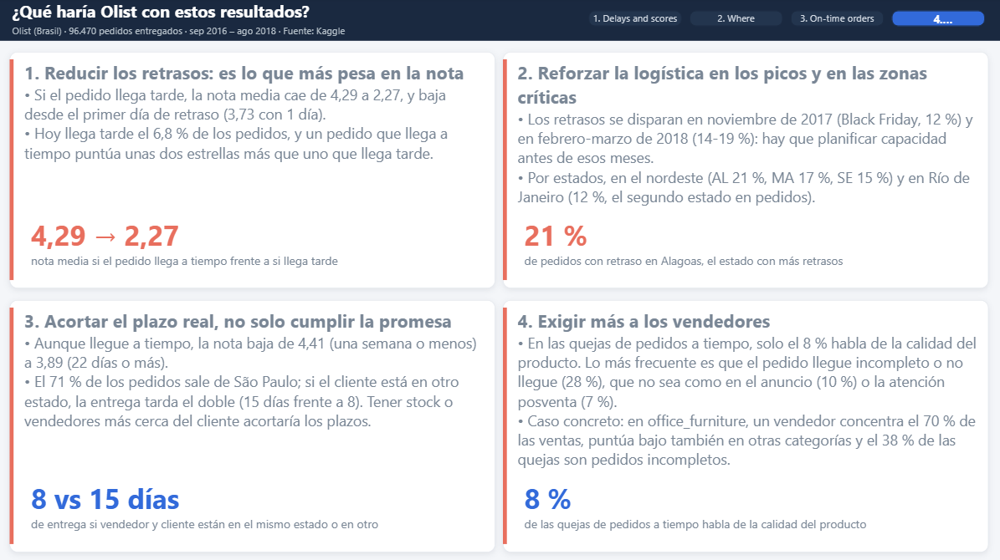
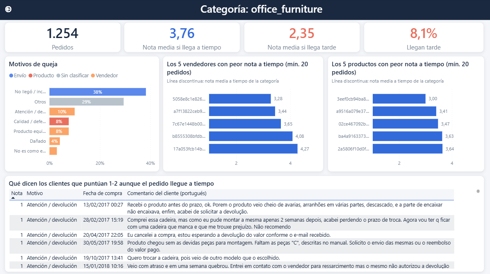

# Olist: ¿los retrasos en la entrega bajan la nota de los clientes?

*English summary: analysis of 96,470 delivered orders from Olist, a Brazilian e-commerce marketplace (2016-2018, public dataset on Kaggle). SQL (DuckDB) cleans and joins the data; a Power BI dashboard shows that late deliveries drop the average review from 4.29 to 2.27 stars, where and when delays happen, and why orders that arrive on time still get bad reviews (classifying 1-2 star comments by keywords). It ends with four business recommendations.*

## La pregunta

> ¿Los retrasos en la entrega bajan la nota que ponen los clientes? Y si es así: ¿dónde y cuándo se producen, y qué más baja la nota cuando el pedido llega a tiempo?

## Los datos

- **[Brazilian E-Commerce Public Dataset by Olist](https://www.kaggle.com/datasets/olistbr/brazilian-ecommerce)** (Kaggle, licencia CC BY-NC-SA 4.0): unos 100.000 pedidos de 2016 a 2018 de un marketplace brasileño, repartidos en 9 tablas (pedidos, artículos, productos, vendedores, clientes, pagos, reviews, geolocalización y traducción de categorías).
- Se analizan los **96.470 pedidos entregados** con fecha de entrega.
- Los CSV originales no están en el repositorio: se descargan de Kaggle.

## Cómo está hecho

```
CSV de Kaggle
   │  SQL (DuckDB)
   ├─► 01  carga las 9 tablas
   ├─► 02  exploración: duplicados, nulos, fechas imposibles; vista base pedidos_entregados
   ├─► 03  limpieza: pedidos_limpios, items_entregados, productos, vendedores
   ├─► 04  consultas de análisis
   └─► 05  exporta las tablas finales a CSV
   ▼
Power BI (Olist.pbix): modelo en estrella + medidas DAX + 4 páginas y una de detalle
```

**Decisiones de limpieza** (documentadas en los SQL):
- Solo pedidos entregados; se excluyen 8 sin fecha de entrega al cliente.
- 674 tiempos de preparación y 20 de transporte negativos (fechas en orden imposible): el pedido se mantiene y el tiempo queda vacío.
- 547 pedidos con varias reviews: se usa la más reciente.
- 1.275 pedidos con varios vendedores (1,3 %): no se usan en el análisis por vendedor.
- Motivo de las quejas: los comentarios de 1-2 estrellas se clasifican con palabras clave en portugués (no llegó o incompleto, no es como el anuncio, calidad, atención, producto equivocado, dañado).

**Modelo en Power BI:** `items_entregados` en el centro, relacionada con `pedidos_limpios`, `productos` y `vendedores`. El mapa de hexágonos es una imagen SVG generada por una medida DAX.

## Resultados

- **Los retrasos hunden la nota:** un pedido que llega a tiempo tiene una nota media de 4,29; uno que llega tarde, 2,27. La nota cae desde el primer día de retraso (3,73 con 1 día) y se queda en torno a 1,7 a partir de una semana.
- **Llegan tarde el 6,8 % de los pedidos**, concentrados en picos de demanda: noviembre de 2017 (Black Friday, 12 %) y febrero-marzo de 2018 (14-19 %).
- **Dónde:** en el nordeste (Alagoas 21 %, Maranhão 17 %, Sergipe 15 %) y en Río de Janeiro (12 %). El norte tarda más de 20 días, pero casi nunca llega tarde: allí la fecha prometida ya es larga.
- **Aunque llegue a tiempo, esperar baja la nota:** 4,41 si tarda una semana o menos y 3,89 si tarda 22 días o más. El 71 % de los pedidos sale de São Paulo, y entregar en otro estado tarda el doble (15 días frente a 8).
- **Es sobre todo logística, no producto:** en las categorías grandes la nota es de 4,1-4,4 si llega a tiempo y cae a 2,1-2,6 si llega tarde. En las quejas de pedidos a tiempo, solo el 8 % habla de la calidad; lo más frecuente es que el pedido llegue incompleto o no llegue (28 %).
- **La excepción, office_furniture** (3,76 a tiempo): un vendedor concentra el 70 % de las ventas y puntúa bajo también en otras categorías.

## Recomendaciones

1. **Reducir los retrasos**, que es lo que más pesa en la nota.
2. **Reforzar la logística en los picos** (Black Friday, febrero-marzo) y en el nordeste y Río de Janeiro.
3. **Acortar el plazo real de entrega**, no solo cumplir la promesa: stock o vendedores más cerca del cliente.
4. **Exigir más a los vendedores**: pedidos completos, anuncios fieles al producto y mejor posventa.

## Dashboard (Power BI)









Página de detalle (clic derecho en una categoría → *Obtener detalles*):



## Cómo reproducirlo

1. Descarga los CSV de [Kaggle](https://www.kaggle.com/datasets/olistbr/brazilian-ecommerce).
2. En `SQL/01_Create_tables.sql`, cambia la ruta de la primera línea (`file_search_path`) por la carpeta donde estén los CSV, y en `SQL/05_Crear_CSV.sql` la carpeta de salida.
3. En DuckDB (por ejemplo desde DBeaver), ejecuta en orden: `01`, la primera sentencia de `02` (crea la vista `pedidos_entregados`), `03` y `05`.
4. Abre `powerbi/Olist.pbix` con Power BI Desktop. Ya incluye los datos; para recargarlos desde tus CSV, cambia el parámetro `DataFolder` en *Transformar datos* y pulsa **Actualizar**.

## Estructura

| Archivo | Contenido |
|---|---|
| `SQL/01_Create_tables.sql` | Carga de los CSV de Olist |
| `SQL/02_exploracion.sql` | Exploración y comprobaciones, con los resultados en comentarios |
| `SQL/03_limpieza.sql` | Tablas limpias para Power BI |
| `SQL/04_Analisis.sql` | Consultas de análisis |
| `SQL/05_Crear_CSV.sql` | Exportación de las tablas finales |
| `powerbi/Olist.pbix` | Dashboard |
| `capturas/` | Capturas del dashboard |

## Autor

**Pere Puig Sallés** — Ingeniero Industrial (ETSEIB, UPC), en transición al análisis de datos.
